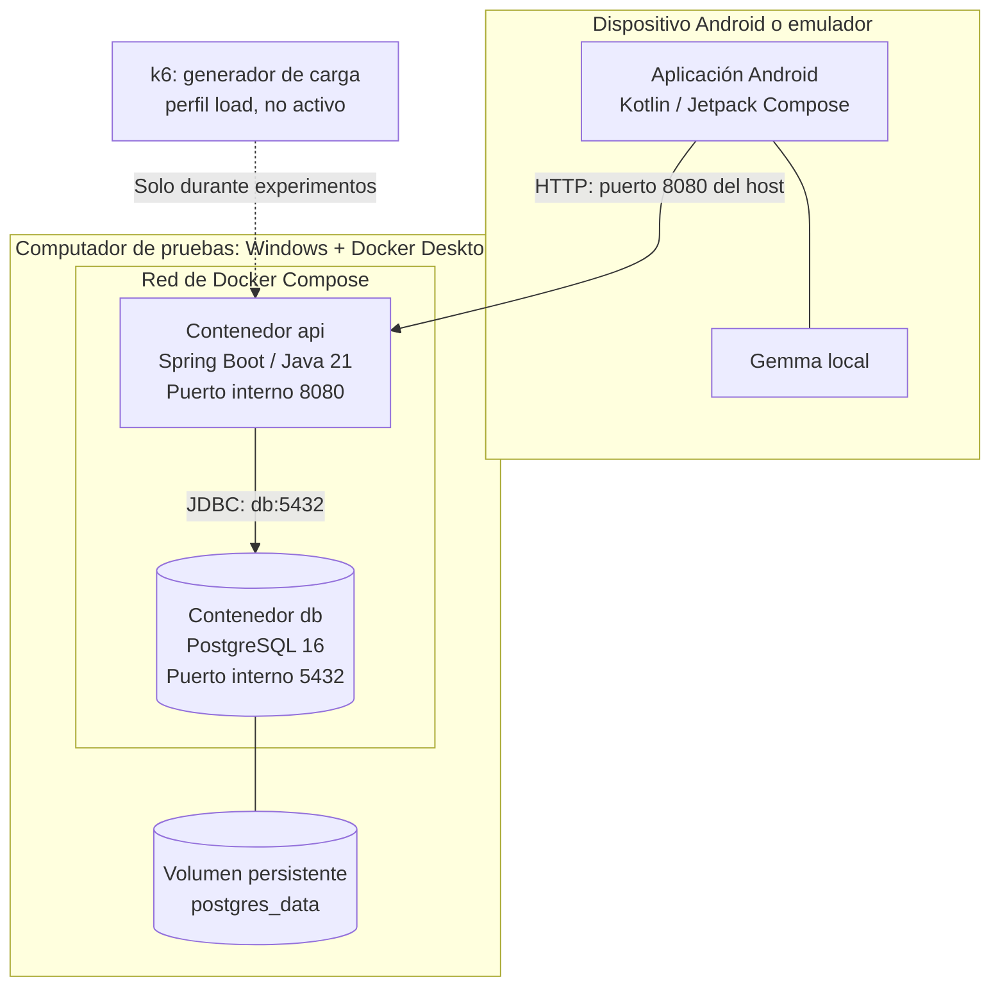

# Diseño de despliegue — Módulo 7

**Proyecto:** Aprende a Aprender  
**Fecha de revisión:** 6 de noviembre de 2026  
**Referencia de código:** rama `main`, a partir del commit `f8e0fc8`  
**Estado:** despliegue local verificado; alternativas futuras no implementadas

## 1. Objetivo

En esta actividad revisamos dónde se ejecuta cada parte de Aprende a Aprender y qué dependencias necesita para funcionar. Separamos la configuración que tenemos hoy de las opciones que podríamos adoptar más adelante. Esta distinción importa porque el proyecto cuenta con un entorno reproducible para desarrollo y pruebas, pero todavía no tenemos evidencia de un despliegue de producción.

## 2. Despliegue actual (as-is)

La aplicación Android está desarrollada con Kotlin y Jetpack Compose. Hace peticiones a una API REST construida con Spring Boot. La API consulta y modifica datos en PostgreSQL 16. En el dispositivo también se ejecuta Gemma localmente para las funciones que lo utilizan; no es un servicio independiente dentro de Docker.

En nuestro equipo de pruebas, Docker Compose levanta dos contenedores: `api` y `db`. El archivo también define `k6`, pero ese servicio pertenece al perfil `load` y no aparece activo en la ejecución normal.

**Límite de lo verificado:** comprobamos los dos contenedores y el endpoint de salud desde el computador. No realizamos en esta actividad una nueva prueba de extremo a extremo desde un teléfono físico o emulador.

### Componentes y responsabilidades

| Elemento | Dónde se ejecuta | Responsabilidad | Evidencia |
|---|---|---|---|
| Android | Teléfono o emulador, cuando se inicia la aplicación | Interfaz, sesión del cliente y consumo de API | `app/`, `ApiClient.kt`, `app/build.gradle.kts` |
| Gemma local | Dispositivo Android, cuando se utiliza esa función | Generación local asociada a los retos | `app/src/main/java/com/example/aprendeaprender/data/ai/` |
| API | Contenedor `api` en Docker Desktop | Autenticación, reglas de negocio y acceso a datos | `backend/Dockerfile`, `docker-compose.yml` |
| PostgreSQL | Contenedor `db` | Almacenar usuarios, sesiones, materias y tareas | `docker-compose.yml`, migraciones Flyway |
| Volumen `postgres_data` | Almacenamiento administrado por Docker | Persistir datos entre reinicios del contenedor | `docker compose volumes` |
| k6 | Contenedor opcional del perfil `load` | Generar carga experimental; no atiende solicitudes de la aplicación | `docker-compose.yml`, `experimentos/` |

### Conexiones y configuración

- La API se conecta a PostgreSQL utilizando el nombre de servicio `db`, en el puerto interno `5432`; toma los parámetros de conexión de variables de entorno.
- Docker publica el puerto `8080` de la API y el `5432` de PostgreSQL con dirección `0.0.0.0` en el host. Son interfaces de escucha, no pruebas de que los servicios sean accesibles desde Internet.
- La aplicación Android utiliza una URL de API configurable. En el emulador, el valor local por defecto apunta a `http://10.0.2.2:8080/`.
- El manifiesto de Android permite tráfico HTTP sin cifrar (`usesCleartextTraffic="true"`). Esto facilita el laboratorio, pero no debe trasladarse sin revisión a un despliegue externo.
- PostgreSQL dispone de un volumen persistente. **Persistencia no equivale a respaldo:** no hemos verificado copias de seguridad ni recuperación de datos.

## 3. Evidencia obtenida en el laboratorio

Ejecutamos los comandos sobre el proyecto local el 6 de noviembre de 2026:

| Comprobación | Resultado observado |
|---|---|
| `docker compose config --services` | `db`, `api` |
| `docker compose ps` | `api` saludable y `db` saludable |
| `docker compose port api 8080` | `0.0.0.0:8080` |
| `docker compose port db 5432` | `0.0.0.0:5432` |
| `docker compose volumes` | `proyecto-arquitecturasoftware_postgres_data`, controlador `local` |
| `GET http://localhost:8080/actuator/health` | `status: UP`; grupos `liveness` y `readiness` |

El endpoint de salud indica que la aplicación respondió correctamente a esa comprobación. Por sí solo no confirma el funcionamiento de todas las operaciones, la conexión desde Android ni la recuperación ante una falla real.

## 4. Riesgos detectados en el despliegue actual

| Riesgo | Evidencia o motivo | Impacto posible | Tratamiento propuesto | Estado |
|---|---|---|---|---|
| Exposición de PostgreSQL a otras interfaces de red | Puerto `5432` publicado en `0.0.0.0` | Aumenta la superficie de acceso a la base de datos | Evitar publicar el puerto cuando no sea necesario; restringirlo mediante red y firewall; adaptar antes las pruebas que usan `host.docker.internal` | Pendiente |
| Tráfico del cliente por HTTP | URL local `http://...` y `usesCleartextTraffic="true"` | Riesgo de interceptación fuera de un laboratorio controlado | Usar HTTPS/TLS y una política de tráfico de red apropiada antes de exponer la API | Pendiente |
| Dependencia de una sola instancia de API y BD | Un contenedor de cada servicio | Una caída deja sin servicio a la aplicación | Definir monitoreo, recuperación y respaldos; valorar redundancia solo con requisitos y evidencia | Pendiente |
| Pérdida o daño del volumen | Hay persistencia local, sin respaldo comprobado | Pérdida de información | Implementar y ensayar copia/restauración de PostgreSQL | Pendiente |
| Falta de observabilidad detallada | Verificamos `health`, pero todavía no hay Prometheus ni Grafana en Compose | Dificulta explicar degradaciones bajo carga | Instrumentar métricas, registrar consultas y establecer umbrales basados en mediciones | Pendiente |

**Precaución técnica:** si restringimos el puerto de PostgreSQL al `localhost` del host, podría dejar de funcionar el mecanismo de pruebas que actualmente conecta desde otro contenedor mediante `host.docker.internal:5432`. Antes de cambiar la publicación del puerto debemos ajustar esa ruta o ejecutar las pruebas dentro de la misma red de Compose.

## 5. Alternativas de despliegue (to-be, no implementadas)

**Alternativa A. Mantener Docker Compose local y reforzar la configuración.** Conservar un contenedor de API y uno de PostgreSQL, controlar mejor la exposición de puertos, añadir métricas y definir un procedimiento de respaldo. Es la opción de menor cambio para el laboratorio y las demostraciones.

**Alternativa B. Ejecutar API y base de datos en una máquina virtual.** Desplegar los servicios en un servidor con HTTPS, firewall, acceso administrativo controlado y respaldos. Facilitaría acceso remoto, pero exige operación continua y recursos de infraestructura.

**Alternativa C. API replicada y base de datos administrada.** Usar más de una instancia de API detrás de un balanceador y un PostgreSQL administrado. Puede mejorar ciertas condiciones de disponibilidad o escalado, pero incrementa costo, complejidad y tareas operativas. No está justificada únicamente con los resultados actuales.

### Comparación de costo relativo

Usamos una escala cualitativa de **1 (bajo) a 5 (alto)**. Son estimaciones del esfuerzo y la complejidad relativos, no cotizaciones, mediciones ni presupuestos aprobados por el equipo.

| Alternativa | Infraestructura | Operación | Complejidad técnica | Recuperación y respaldos | Comentario |
|---|---:|---:|---:|---:|---|
| A. Compose local reforzado | 1 | 2 | 2 | 3 | Adecuada para desarrollo; recuperación sigue siendo responsabilidad del equipo |
| B. Servidor/VM con TLS | 3 | 4 | 3 | 3 | Permite operación remota, requiere administración de sistema y respaldos |
| C. API replicada + BD administrada | 5 | 4 | 5 | 4 | Más componentes y costo; parte de la recuperación puede apoyarse en el proveedor |

Las puntuaciones son comparativas y pueden cambiar según el proveedor, el volumen de usuarios, los requisitos de disponibilidad y las capacidades del equipo. **No se ha tomado en este documento una nueva decisión arquitectónica:** la selección debe registrarse y justificarse en su ADR correspondiente.

## 6. Operación y recuperación

En el laboratorio podemos verificar el estado con `docker compose ps` y consultar `http://localhost:8080/actuator/health`. Para investigar una falla, los logs de los servicios se pueden consultar con `docker compose logs api` y `docker compose logs db`. Estos comandos son parte del procedimiento propuesto; no todos fueron ejecutados como parte de esta revisión.

No debemos usar `docker compose down -v` como procedimiento habitual de recuperación: la opción `-v` elimina volúmenes y podría borrar los datos de PostgreSQL. Tampoco podemos afirmar que existe recuperación automática ni que hay respaldos válidos sin haberlos probado.

**Responsables operativos:** la asignación formal dentro del equipo está pendiente. Antes de un despliegue externo se deberá establecer quién revisa alertas, quién ejecuta respaldos y quién autoriza cambios de infraestructura.

## 7. Relación con otras evidencias arquitectónicas

Este documento será la base de la **vista física del modelo 4+1** y debe ser coherente con `docs/c4/02-contenedores.puml` y las decisiones registradas en `docs/adr/`. Para explicar los problemas de crecimiento, se relacionará también con `docs/modulo-6/` y los resultados de `experimentos/crecimiento-m6/`.

La siguiente actividad es construir el plan de observabilidad: qué fallos queremos detectar, qué señales recogeremos y qué se podrá mostrar realmente en Prometheus y Grafana.