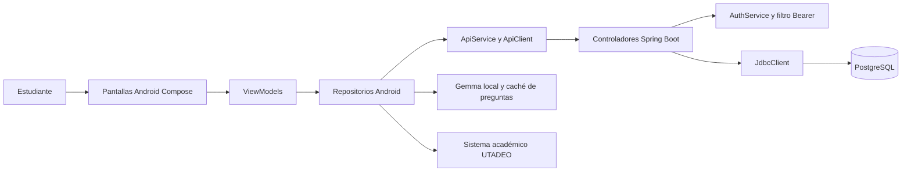
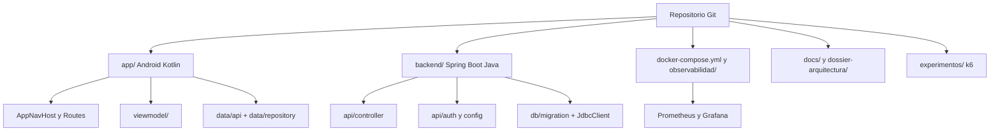
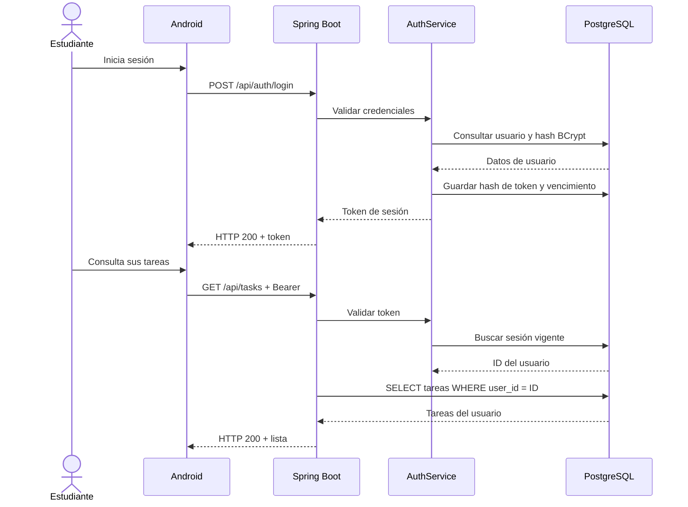
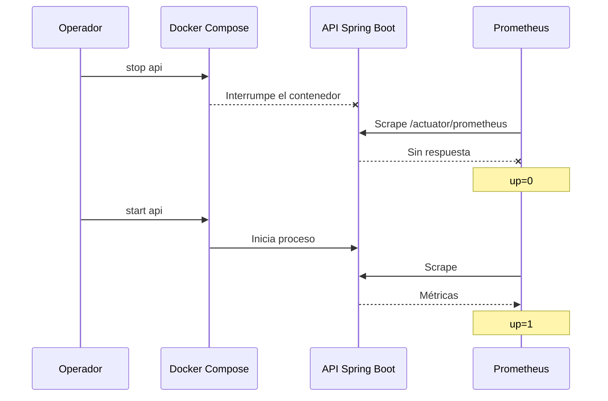
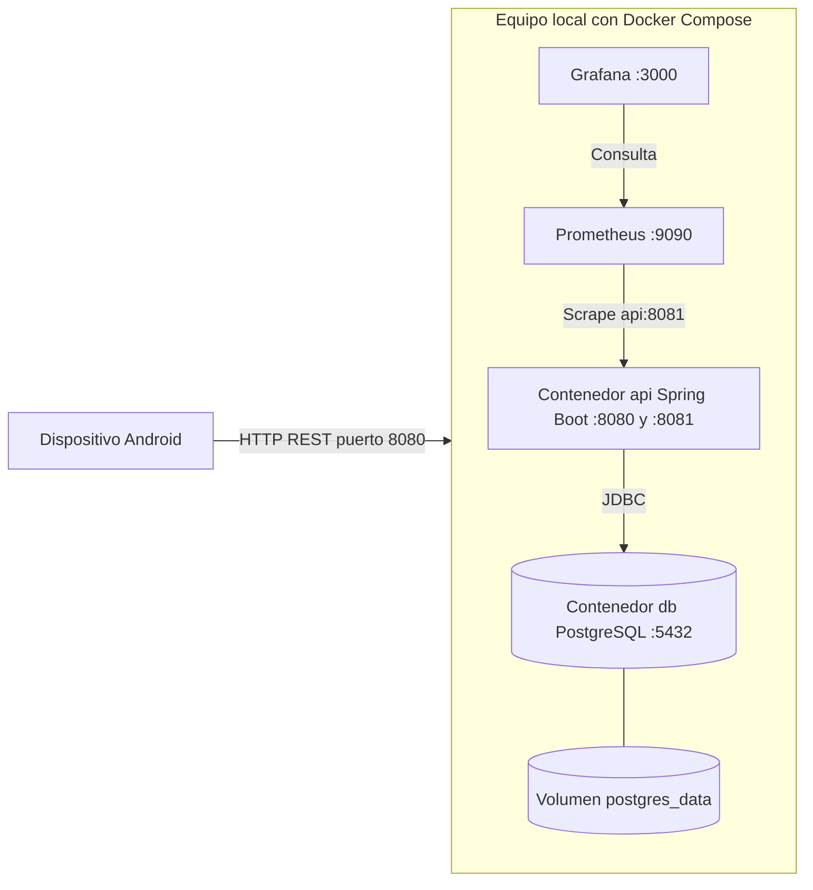

# Vistas arquitectónicas 4+1 — Aprende a Aprender

**Módulo:** 7  
**Estado:** vistas documentales basadas en código de `main`; no implican nuevas funcionalidades implementadas  
**Fecha:** 6 de noviembre de 2026

## Alcance y relación con C4

El modelo **4+1** complementa los diagramas C4 existentes de contexto, contenedores y componentes en `docs/c4/`. No los reemplaza: el 4+1 explica el sistema desde cinco preguntas distintas. Las vistas describen principalmente lo implementado; cualquier mejora aún no desarrollada queda señalada como propuesta.

## 1. Vista lógica — responsabilidades del sistema

Separamos las responsabilidades en el cliente Android y el backend. El cliente controla la navegación, presentación, autenticación local de la sesión y orquestación de repositorios; Spring Boot aplica autenticación, reglas de acceso por usuario y persistencia; PostgreSQL guarda usuarios, materias, tareas y retos.

**Decisión de diseño observada:** el control de propiedad de las tareas se encuentra en las consultas del backend mediante `user_id`; no se delega al cliente Android. Gemma trabaja localmente y no constituye un microservicio remoto. La conexión de Android con UTADEO es independiente de la API de persistencia propia.

## 2. Vista de desarrollo — organización del código

Los límites de despliegue **no coinciden** con cada paquete de código: el backend sigue siendo una API Spring Boot unificada. Extraer tareas como microservicio fue una alternativa evaluada, no la decisión adoptada.

## 3. Vista de procesos — escenarios de ejecución

### Escenario A: autenticación y consulta de tareas

**Límite:** Android sigue utilizando `GET /api/tasks` sin paginación en `TaskRepository.getMyTasks()`. Aunque el backend expone `/api/tasks/page` y se probó su rendimiento, la adopción en Android está pendiente.

### Escenario B: recuperación manual observada

La evidencia procede del experimento registrado en `docs/modulo-7/05-riesgos-operativos-recuperacion.md`. No hay failover ni reinicio autónomo comprobado.

## 4. Vista física — despliegue observado en laboratorio

El archivo Compose principal publica los puertos 8080 y 5432 en todas las interfaces del host; el Compose adicional publica Prometheus y Grafana solo en localhost. El puerto de gestión 8081 funciona en la red interna de Docker. Esta es la topología del laboratorio, **no** una infraestructura pública con TLS, réplicas o balanceo.

## +1. Escenarios y evidencia de calidad

| Escenario | Propiedad | Evidencia | Límite |
| --- | --- | --- | --- |
| Un usuario A consulta sus tareas | Aislamiento | `TaskPaginationFitnessTest` con PostgreSQL; verde–rojo–verde | Prueba focalizada, no auditoría integral |
| GET de tareas ante 30 VUs | Rendimiento | 19.303 GET completados; 311,59 GET/s; cero fallos; p95 HTTP agregado 119,01 ms | p95 incluye login, no representa exclusivamente GET |
| La API se detiene y se inicia | Recuperabilidad manual | `up=1` → `up=0` → `up=1`, health `UP` y ruta protegida responde 403 | Sin RTO medido, sin autorrecuperación |
| Peticiones concurrentes a PostgreSQL | Capacidad operativa | Máximo 10 activas, 14 pendientes y cero timeouts del pool | No identifica el cuello de botella |
| La app pide 50 tareas paginadas | Eficiencia por respuesta | Endpoint `/api/tasks/page`, ADR-007 y comparación M6 | Android todavía usa consulta original |

## Trazabilidad mínima

- `app/src/main/java/com/example/aprendeaprender/navigation/AppNavHost.kt`
- `app/src/main/java/com/example/aprendeaprender/data/api/ApiService.kt`
- `app/src/main/java/com/example/aprendeaprender/data/repository/TaskRepository.kt`
- `backend/src/main/java/com/example/aprendeaprender/api/controller/{AuthController,TaskController,SubjectController,ChallengeController}.java`
- `backend/src/main/java/com/example/aprendeaprender/api/auth/AuthService.java`
- `backend/src/main/java/com/example/aprendeaprender/api/config/SecurityConfig.java`
- `backend/src/main/resources/db/migration/`
- `docker-compose.yml`, `docker-compose.observabilidad.yml`, `observabilidad/`
- `docs/c4/`, `docs/modulo-7/04-resultados-observabilidad.md`, `docs/modulo-7/05-riesgos-operativos-recuperacion.md`

## Puntos pendientes

Los diagramas no prueban por sí mismos el funcionamiento. Falta comprobar visualmente la representación Mermaid en GitHub, añadir referencias a los screenshots originales de Grafana cuando queden versionados, validar el estado del pipeline de CI y preparar el cierre del Módulo 8. La recuperación de PostgreSQL desde respaldo y el despliegue público seguro siguen sin comprobarse.
